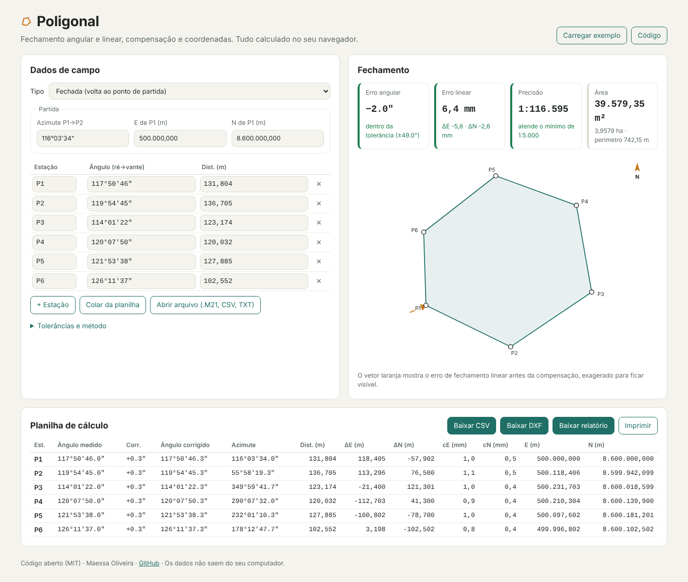

# Voo Drone

[](https://github.com/maessa-oliveira/voo-drone/actions/workflows/ci.yml)
[](https://maessa-oliveira.github.io/voo-drone/)
[](LICENSE)

**Mapeamento com drone DJI pelo celular.** Abra a área em **KML ou KMZ** (Google Earth, QGIS, arquivo do
cliente, KMZ da AS com área ou eixo do duto), escolha o drone, a altura e as sobreposições, e o Voo Drone gera a **missão de waypoints para o
app DJI Fly** (Mini 4 Pro e Air 3), já dividida em partes de até 200 pontos e uma bateria.

👉 **[Abrir no celular](https://maessa-oliveira.github.io/voo-drone/)**: dá para instalar na tela inicial e abrir sem internet (o mapa de fundo precisa de internet).



> 🇬🇧 *Phone-friendly mapping-mission planner for DJI Fly drones (Mini 4 Pro, Air 3): open a KML/KMZ area and
> get DJI waypoint KMZ missions (WPML), split to 200 waypoints and one battery each.*

## O que calcula

| Grandeza | Fórmula |
|---|---|
| GSD (cm/px) | sensor × altura ÷ (focal × pixels) |
| Pegada da foto | GSD × pixels (largura e altura) |
| Espaçamento entre linhas | largura da pegada × (1 − sobreposição lateral) |
| Espaçamento entre fotos | altura da pegada × (1 − sobreposição frontal), nunca maior que isso |
| Velocidade | menor entre: base ÷ intervalo da câmera, arrasto ≤ 0,5 px a 1/1000 s, 10–12 m/s |
| Partes da missão | até 200 pontos (limite do DJI Fly) e o tempo útil de uma bateria menos 3 min |
| Precisão esperada | H ≈ 1–2 × GSD, V ≈ 1,5–3 × GSD (com pontos de controle) |

- **KMZ da obra (AS):** o arquivo pode ter várias áreas, eixos e marcos. O app lista as áreas e os eixos
  para você escolher (os marcos são ignorados). Se escolher um **eixo** (duto, estrada, rede), ele monta a
  **faixa** com a largura que você define e voa linhas paralelas ao eixo.
- Linhas em **zigue-zague** recortadas no polígono (funciona em áreas côncavas), com direção
  **automática pelo lado mais longo** (menos curvas).
- Dois jeitos de fotografar: **parar em cada foto** (um ponto por foto, o mais garantido no DJI Fly) ou
  **foto por distância** (pontos só nas pontas das linhas; experimental, nem toda versão do app dispara).
- **KMZ de teste** com 5 fotos, para conferir no campo antes do voo completo.
- **Conferir fotos** depois do voo: escolha as fotos baixadas e, pelo GPS de cada uma (EXIF), o mapa mostra
  os pontos fotografados (verde), os que faltam (vermelho) e a parte que precisa ser refeita. Baixa a lista
  das fotos **na ordem do voo** (CSV). As fotos são lidas só no aparelho, nada é enviado.

## Levar a missão para o DJI Fly

O DJI Fly não tem botão de importar. O jeito é trocar o arquivo de uma missão salva no app:

1. No DJI Fly, com o drone ligado, abra **Waypoints**, marque 2 ou 3 pontos e salve (a "missão-modelo").
   Faça uma para cada parte.
2. Abra a pasta da missão salva (a mais recente):
   - **iPhone/iPad:** app Arquivos → No meu iPhone → DJI Fly → `wayline_mission`;
   - **Android ou DJI RC 2:** pelo computador, cabo USB, em `Android/data/dji.go.v5/files/waypoint`.
3. Troque o `.kmz` de dentro pelo gerado aqui, **com o mesmo nome**. Dica: abra a missão-modelo no
   Voo Drone ("Missão-modelo do DJI Fly") e o arquivo já sai com o nome certo e o código do drone dela.
4. Feche o DJI Fly de verdade e abra de novo.

> Alturas relativas à decolagem: o DJI Fly não segue o relevo. O formato da missão (WPML) segue a
> documentação pública da DJI e missões salvas pelo próprio DJI Fly; **voe primeiro o KMZ de teste**, com
> o drone à vista. Respeite as regras da ANAC/DECEA (SARPAS).

- `src/voo.js`: todo o cálculo e a montagem do KMZ, **sem dependência de navegador** (testado em Node).
- `src/app.js`: interface com Leaflet.

## Testes

```bash
npm install
npm test          # cálculo, partes de 200 pontos, XML e KMZ da missão DJI Fly
npm run test:e2e  # abre a página num Chromium real (computador e celular), abre KML/KMZ e baixa as missões
```

> Planejamento de referência. Antes de voar, confira as regras da ANAC/DECEA (SARPAS) e o manual
> do equipamento.

## English

**Mapping missions for DJI Fly drones (Mini 4 Pro, Air 3), from your phone.**

- Open the area as **KML/KMZ** or draw it; pick altitude and overlaps.
- Computes GSD, serpentine flight lines (concave areas supported), photo stations, speed, flight time.
- Exports **DJI waypoint KMZ** (`wpmz/template.kml` + `wpmz/waylines.wpml`), split into parts of up to
  200 waypoints and one battery. Replace a placeholder mission saved by DJI Fly with it, keeping the same
  file name. Altitudes are relative to take-off: **fly the 5-photo test KMZ first**.

👉 [Try it](https://maessa-oliveira.github.io/voo-drone/) · `npm test` · `npm run test:e2e`

## Licença

MIT.
